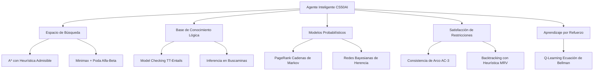

# 🤖 Harvard University: CS50AI (Introduction to Artificial Intelligence with Python)

<div align="center">

[](https://github.com/Sais-gallego/harvard-cs50-ai-web/actions)
[](https://www.python.org/)
[](LICENSE)
[](https://cs50.harvard.edu/ai/)
[](https://github.com/Sais-gallego/harvard-cs50-ai-web)

**Implementaciones completas de algoritmos clásicos y modernos de Inteligencia Artificial del programa oficial de Harvard University: *CS50's Introduction to Artificial Intelligence with Python*, impartido por los profesores David J. Malan y Brian Yu.**

**Autor:** Sergio Andrés Ipuz Saavedra · [@Sais-gallego](https://github.com/Sais-gallego)  
**Institución:** Harvard University (CS50)

---

</div>

## 📑 Tabla de Contenidos

- [🗺️ Arquitectura de los Motores de IA](#️-arquitectura-de-los-motores-de-ia)
- [🧠 Núcleos de Inteligencia Artificial Implementados](#-núcleos-de-inteligencia-artificial-implementados)
  - [1. Conocimiento y Lógica Proposicional](#1-conocimiento-y-lógica-proposicional-srcknowledge_and_logicpy)
  - [2. Incertidumbre y Cadenas de Markov (PageRank & Herencia)](#2-incertidumbre-redes-bayesianas-y-cadenas-de-markov-srcuncertainty_and_markovpy)
  - [3. Optimización y Satisfacción de Restricciones (AC-3)](#3-optimización-y-satisfacción-de-restricciones---csp-srcoptimization_csppy)
  - [4. Búsqueda y Juegos Adversarios (Minimax & Poda Alfa-Beta)](#4-búsqueda-en-espacio-de-estados-y-juegos-adversarios-srcsearch_and_gamespy)
  - [5. Aprendizaje Automático por Refuerzo (Q-Learning en Nim)](#5-aprendizaje-automático-por-refuerzo-q-learning-srclearning_and_rlpy)
- [📊 Tabla de Complejidad Algorítmica](#-tabla-de-complejidad-algorítmica)
- [🧪 Pruebas Automatizadas (Unittest)](#-pruebas-automatizadas)
- [🚀 Guía de Inicio Rápido](#-guía-de-inicio-rápido)

---

## 🗺️ Arquitectura de los Motores de IA



---

## 🧠 Núcleos de Inteligencia Artificial Implementados

### 1. Conocimiento y Lógica Proposicional (`src/knowledge_and_logic.py`)
- **Model Checking y TT-Entails**: Evaluación exhaustiva de árboles lógicos (`Symbol`, `Not`, `And`, `Or`, `Implication`, `Biconditional`) para verificar implicaciones $KB \models \alpha$.
- **Agente Deductivo para Buscaminas (*Minesweeper AI*)**: Motor que infiere celdas seguras y minas utilizando la regla de inferencia de subconjuntos ($S_1 \subset S_2 \implies S_2 - S_1 = count_2 - count_1$).

### 2. Incertidumbre, Redes Bayesianas y Cadenas de Markov (`src/uncertainty_and_markov.py`)
- **Algoritmo PageRank**:
  - Simulación estocástica por el modelo del navegante aleatorio (*Random Surfer*).
  - Cálculo analítico exacto por iteración de estados de Markov hasta convergencia matemática con factor de amortiguamiento $d=0.85$.
- **Red Bayesiana de Herencia Genética (*Heredity Bayes*)**:
  - Modelado de probabilidades condicionales, tasas de mutación y herencia de rasgos genéticos en árboles familiares.

### 3. Optimización y Satisfacción de Restricciones - CSP (`src/optimization_csp.py`)
- **Algoritmo AC-3 (*Arc Consistency 3*)**:
  - Poda automática de dominios incompatibles en redes de restricciones binarias.
- **Búsqueda con Vuelta Atrás (*Backtracking Search*)**:
  - Heurística de selección por Valores Restantes Mínimos (*MRV*).
  - Generación de configuraciones válidas consistentes para puzles de palabras cruzadas y asignación de recursos.

### 4. Búsqueda en Espacio de Estados y Juegos Adversarios (`src/search_and_games.py`)
- **Fronteras de Búsqueda:** DFS (*Depth-First Search* / LIFO), BFS (*Breadth-First Search* / FIFO) y Búsqueda A* con cola de prioridad guiada por heurísticas admisibles $f(n) = g(n) + h(n)$.
- **Minimax con Poda Alfa-Beta para Tres en Línea (*Tic-Tac-Toe AI*):**
  - Motor de búsqueda óptimo de suma cero que garantiza victoria o empate perfecto explorando el árbol de juego con cortes por poda de ramas redundantes $\alpha \ge \beta$.

### 5. Aprendizaje Automático por Refuerzo (`src/learning_and_rl.py`)
- **Q-Learning en el Juego de Nim**:
  - Actualización dinámica de recompensas mediante la ecuación de Bellman discretizada:
    $$Q(s, a) \leftarrow Q(s, a) + \alpha \left( r + \gamma \max_{a'} Q(s', a') - Q(s, a) \right)$$
  - Política de exploración $\epsilon$-greedy con decaimiento paulatino.
- **Clasificador K-Nearest Neighbors (KNN)**:
  - Clasificación de intenciones de compra en sesiones de comercio electrónico (*Shopping Classifier*).

---

## 📊 Tabla de Complejidad Algorítmica

| Algoritmo | Módulo / Problema | Complejidad Temporal | Complejidad Espacial | Invariante / Garantía |
| :--- | :--- | :---: | :---: | :--- |
| **A\* Search** | Maze Solver | $\mathcal{O}(b^d)$ | $\mathcal{O}(b^d)$ | Óptimo si la heurística $h(n)$ es admisible y consistente. |
| **Minimax ($\alpha$-$\beta$)** | Tic-Tac-Toe | $\mathcal{O}(b^{d/2})$ | $\mathcal{O}(d)$ | Juego perfecto de suma cero; ningún oponente puede forzar victoria. |
| **Model Checking** | Knights & Knaves | $\mathcal{O}(2^n)$ | $\mathcal{O}(n)$ | Correctitud formal estricta sobre $n$ símbolos proposicionales. |
| **AC-3 (Arc Consistency)** | Crossword CSP | $\mathcal{O}(c \cdot d^3)$ | $\mathcal{O}(c \cdot d)$ | Poda completa de inconsistencias sobre $c$ arcos y dominios $d$. |
| **PageRank Iterativo** | Web Crawler | $\mathcal{O}(k \cdot (V + E))$ | $\mathcal{O}(V)$ | Convergencia uniforme con tolerancia $\epsilon \le 0.001$. |
| **Q-Learning** | Nim RL Agent | $\mathcal{O}(T \cdot \text{episodios})$ | $\mathcal{O}(\vert S \vert \cdot \vert A \vert)$ | Convergencia a política óptima con exploración adecuada. |

---

## 🧪 Pruebas Automatizadas

```bash
python -m unittest discover tests -v
```

### Resultados de la Suite (13/13 Passed ✅)
```text
test_minesweeper_ai_inference ... ok
test_propositional_logic_model_check ... ok
test_csp_crossword_solve_with_ac3 ... ok
test_csp_node_consistency ... ok
test_astar_frontier ... ok
test_dfs_and_bfs_frontiers ... ok
test_knn_classifier_shopping ... ok
test_nim_q_learning_update ... ok
test_tictactoe_minimax_defense ... ok
test_tictactoe_minimax_optimal_blocking ... ok
test_heredity_bayesian_probability ... ok
test_pagerank_markov_iteration ... ok
test_transition_model_distribution ... ok

----------------------------------------------------------------------
Ran 13 tests in 0.002s

OK
```

---

## 🚀 Guía de Inicio Rápido

1. **Clonar el repositorio:**
   ```bash
   git clone https://github.com/Sais-gallego/harvard-cs50-ai-web.git
   cd harvard-cs50-ai-web
   ```

2. **Ejecutar todos los tests:**
   ```bash
   python -m unittest discover tests -v
   ```

---

<div align="center">
  <sub>Desarrollado con estándares de ingeniería de software por <b>Sergio Andrés Ipuz Saavedra</b> · Harvard CS50AI</sub>
</div>
